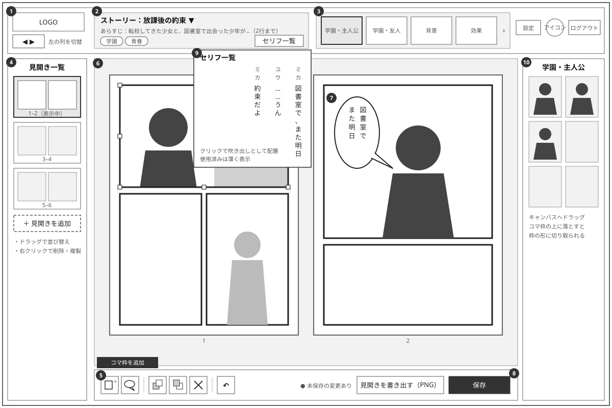

# 漫画作成画面

> 2026年10月に、[ロードマップ](../../00-roadmap.md)段階2a「最初の1本の流れ」に向けて全面的に見直した。ワイヤーフレームの番号は、3章の表の No と対応する。旧版のワイヤーフレームは [CreateManga.drawio.png](../wireframes/CreateManga.drawio.png)。

---

## 1. 画面概要

イラスト素材・コマ枠・吹き出しを**見開き（左右2ページ）単位**で配置し、漫画（ネームや完成した漫画）を作成する画面。使うストーリーと素材フォルダは、この画面の中で選ぶ（ストーリーなしでも始められる）。1つのストーリーから、複数の漫画を作れる。

---

## 2. 画面情報

| 項目 | 内容 |
|------|------|
| 画面ID | SCR-007 |
| 画面名 | 漫画作成画面 |
| URL | `/CreateMangaPage`（新規）、`/CreateMangaPage?mangaId=<漫画ID>`（続きの編集）、`/CreateMangaPage?storyId=<ストーリーID>`（ストーリーを選んだ状態で新規） |
| 権限 | ログインユーザー（ログイン前の体験は段階2bで追加する。[要件定義 REQ-011](../../01-requirements/README.md)） |
| 遷移元 | サイドメニューの「漫画創作」（新規）、ホーム画面のストーリー一覧「このストーリーで漫画を作る」（ストーリーを選んだ状態で新規）、ホーム画面の漫画一覧（続きの編集） |
| 遷移先 | ホーム画面、メモ管理画面、ストーリー管理画面、設定画面、アカウント情報編集画面、ログイン画面（ログアウト時） |

---

## 3. 画面レイアウト

| No | 項目 | 説明 |
|----|------|------|
| 1 | ヘッダー | サービスロゴ、左の列の切り替えボタン、ストーリー欄（2）、素材フォルダ帯（3）、設定ボタン、アカウントボタン、ログアウトボタン |
| 2 | ストーリー欄 | 選んでいるストーリーのタイトル・あらすじ（2行まで）・ジャンルと、「セリフ一覧」ボタン。ストーリーを選んでいない場合は「ストーリーを選ぶ（なしでも始められます）」と表示する |
| 3 | 素材フォルダ帯 | 素材フォルダを横に並べて表示する（表紙はフォルダ内の1枚目の素材）。選んだフォルダの素材が素材一覧（10）に出る |
| 4 | 見開き一覧 | この漫画の見開きをサムネイルで縦に並べる（1–2、3–4…）。表示中の見開きを強調し、末尾に「見開きを追加」を置く。左の列の切り替えボタンで、サイドメニュー（各画面への移動）と入れ替わる |
| 5 | 編集アイコン | 下部の操作欄（8）の左側に、小さなアイコンで並べる（左から：コマ枠を追加、吹き出しを追加、前面へ、背面へ、削除、元に戻す）。キャンバスを広く使うため、文字のボタンにはしない。マウスを乗せると機能名を表示し、画面の読み上げにも機能名を伝える |
| 6 | 編集キャンバス | 表示中の見開き（左右2ページ）。素材・コマ枠・吹き出しを配置する。選んだ要素には、大きさを変えるための持ち手（四隅と各辺の中央）を表示する |
| 7 | 吹き出し | セリフを入れる楕円の吹き出し。文字は縦書き・横書きを切り替えられる。最初の書き方は、選んでいるストーリーの書き方に合わせる（ストーリーなしの場合は縦書き） |
| 8 | 下部の操作欄 | 左に編集アイコン（5）、右に保存していない変更の表示、「見開きを書き出す（PNG）」ボタン、「保存」ボタン |
| 9 | セリフ一覧 | ストーリー欄の「セリフ一覧」から開く。ストーリーのセリフを発言者つきで並べ、クリックすると吹き出しとして配置する。配置済みのセリフは薄く表示する。**表示の書き方（縦書き・横書き）は、ストーリー管理画面で作成・編集するときの書き方に合わせる** |
| 10 | 素材一覧 | 選んでいる素材フォルダの素材をサムネイルで並べる。キャンバスへドラッグして配置する |

---

## 4. 操作

### 4.1 ストーリー・素材フォルダ

| 操作 | 動作 |
|------|------|
| ストーリー欄をクリック | 自分のストーリーの一覧を開き、選んだストーリーにする。すでにセリフを配置している漫画でストーリーを変える場合は、「ストーリーを変えると、配置済みの吹き出しとセリフのつながりが外れます。変更しますか？」と確認する（吹き出しの文字は残す） |
| 「セリフ一覧」をクリック | セリフ一覧（9）を開閉する |
| セリフ一覧のセリフをクリック | 表示中の見開きの中央付近に、そのセリフを入れた吹き出しを配置する |
| 素材フォルダをクリック | 素材一覧に表示するフォルダを切り替える |

### 4.2 見開き

| 操作 | 動作 |
|------|------|
| 見開きのサムネイルをクリック | 編集キャンバスに表示する見開きを切り替える |
| 「見開きを追加」をクリック | 最後に空の見開きを追加し、表示する |
| サムネイルをドラッグ | 見開きの順番を並び替える |
| サムネイルを右クリック →「複製」 | その見開きを複製し、すぐ後ろに追加する |
| サムネイルを右クリック →「削除」 | 確認のうえ、その見開きを削除する。見開きが1つしかない場合は削除できない |
| 左の列の切り替えボタンをクリック | 左の列を、見開き一覧とサイドメニューで入れ替える |

### 4.3 配置と編集

| 操作 | 動作 |
|------|------|
| 素材をキャンバスへドラッグ＆ドロップ | 落とした位置に素材を配置する。**コマ枠の上に落とした場合は、そのコマ枠の中に入り、枠からはみ出た部分は表示しない** |
| 編集アイコン「コマ枠を追加」をクリック | 表示中の見開きに四角形のコマ枠を追加する |
| 編集アイコン「吹き出しを追加」をクリック | 空の吹き出しを追加し、文字の入力を始める |
| 要素をクリック | その要素を選ぶ（持ち手を表示する）。キャンバスの何もない所をクリックすると、選択を外す |
| 要素をドラッグ | 移動する。コマ枠を動かすと、中の素材も一緒に動く |
| 持ち手をドラッグ | 大きさを変える。素材は縦横の比率を保つ。コマ枠と吹き出しは自由に変えられる |
| 吹き出しをダブルクリック | 文字を編集する。縦書き・横書きを切り替えられる |
| 編集アイコン「前面へ」「背面へ」 | 選んでいる要素の重なり順を、1つ上・1つ下に変える |
| 編集アイコン「削除」または Delete キー | 選んでいる要素を削除する。コマ枠を削除すると、中の素材も一緒に削除する |
| 編集アイコン「元に戻す」または Ctrl+Z（Mac は ⌘+Z） | 直前の操作を取り消す。最大20回までさかのぼれる |

### 4.4 保存・書き出し・共通

| 操作 | 動作 |
|------|------|
| 「保存」をクリック | 漫画（見開き・配置・ストーリーとのつながり）を保存する。初めて保存したときに漫画が作られ、URLが `?mangaId=` 付きに変わる |
| 「見開きを書き出す（PNG）」をクリック | 表示中の見開きを1枚の横長の画像にして、端末にダウンロードする。画面の表示より高い解像度（2倍）で書き出す |
| 保存していない変更があるまま、画面を離れる | ブラウザの確認（「このページを離れますか？」）を表示する |
| 設定・アカウント・ログアウト | 他の画面と共通 |

---

## 5. 表示内容

- 見開きは、漫画の中の順番で表示する。新しく作った漫画は、空の見開きが1つある状態で始まる
- 素材は、選んでいる素材フォルダ内の登録順で表示する
- ストーリー欄には、選んでいるストーリーの情報を常に表示する
- 保存していない変更がある場合は、下部の操作欄に「保存していない変更があります」と表示する

---

## 6. エラー・確認

- 漫画・素材フォルダ・ストーリーの読み込みに失敗した場合は、エラーメッセージを表示する
- 保存に失敗した場合は、エラーメッセージを表示し、編集中の内容は画面に残す
- 書き出しに失敗した場合は、エラーメッセージを表示する
- 確認を表示する操作：ストーリーの変更（セリフを配置済みの場合）、見開きの削除、保存していない変更があるまま画面を離れる

---

## 7. 段階2aでは作らないもの

| 項目 | 予定 |
|------|------|
| 拡大表示（キャンバスの一部を大きく見る） | 段階2b |
| 自動保存 | 段階2b |
| 回転・反転 | 段階2b |
| 斜めのコマ枠・自由な形のコマ枠、楕円以外の吹き出し | 段階2b以降 |
| ログイン前の体験（ブラウザへの保存・登録時の引き継ぎ・ロゴ入りの書き出し） | 段階2b |
| 1ページずつの表示への切り替え、スマートフォン向けの縦画面 | 段階6（スマートフォン対応と合わせて検討） |
| PDF・縦読み形式の書き出し、全ページの一括書き出し | 段階6 |

---

## 8. 備考

- **見開き単位にした理由**：漫画は見開きで読まれ、ネームも見開きで考えることが多い。今の実装（キャンバスの背景が左右2ページの見開き1枚）をそのまま活かせる。ページ数は常に偶数になる
- **今の実装との違い**：今はコマ画像の配置がストーリーに直接ひもづいているため、1つのストーリーにつき見開き1つしか作れない。「漫画」と「見開き」を独立したデータにする必要がある（DB・APIの設計は[04-database](../../04-database/README.md)・[05-api](../../05-api/README.md)で更新する）
- **ストーリー選択画面の廃止**：ストーリーと素材フォルダの選択はこの画面の中で行うため、[SCR-006 ストーリー選択画面](TopicChoice.md)は廃止する
- **ストーリーの書き方（縦書き・横書き）**：ストーリーには、今は書き方の設定が無い（メモには有る）。ストーリー管理画面の見直し（段階2b）で設定を追加し、それまではセリフ一覧・吹き出しとも縦書きで表示する
- **サイドメニュー**：旧版のワイヤーフレームの注記（「このページではサイドバーなしの状態でUIは存在しない」）に従い、左の列はサイドメニューと見開き一覧を切り替える形にした
